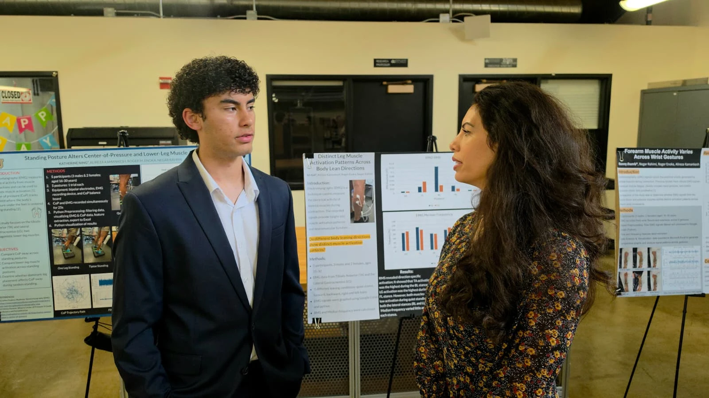
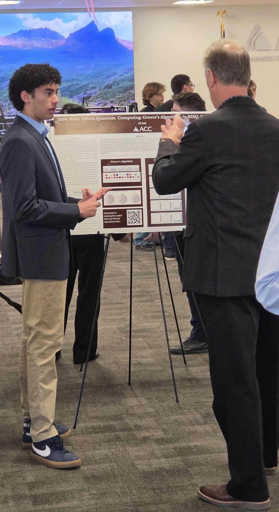
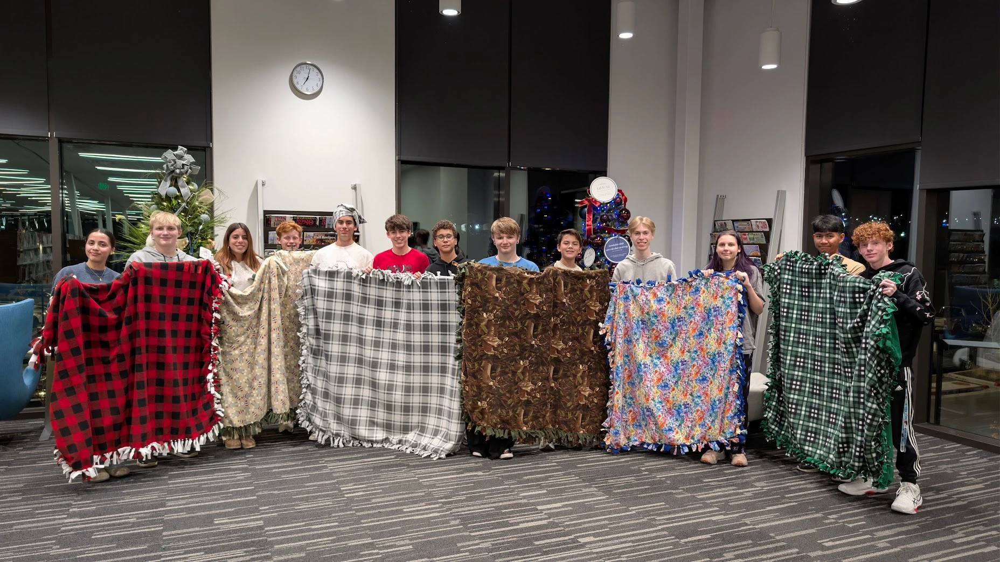
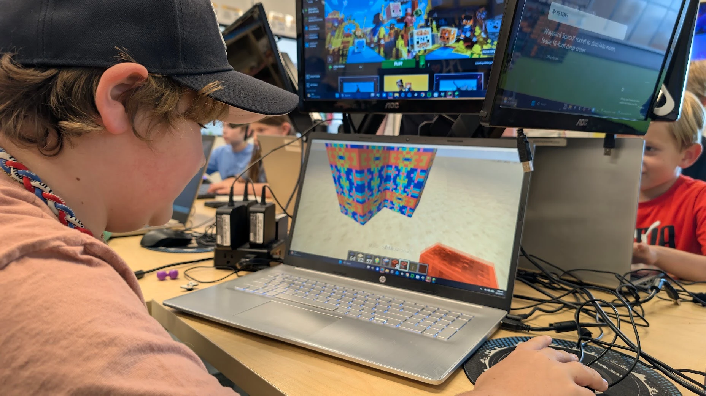
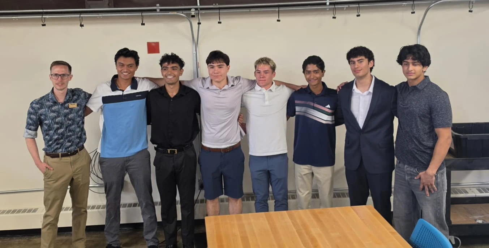

# Deferred / Removed Content

Things taken off the live site temporarily, kept here verbatim so they're trivial to paste back in. Nothing is lost — just off the page for now while the site gets hosted quickly.

---

## Removed 2026-11-06 — "Read Paper (PDF)" link (Quantum Chip Research card)

Removed because the paper isn't written yet. To restore: drop the finished PDF in this folder (suggested name `quantum_paper.pdf`), then add this link back into the `card-links` div of the quantum research card (in the Research section of `index.html`), right before the GitHub Repo link:

```html
<a href="quantum_paper.pdf" target="_blank" rel="noopener noreferrer">Read Paper (PDF) →</a>
```

---

## Restored 2026-11-13 — Projects section

The Projects section (noted below as removed on 2026-11-06) is back, fully built out with real ATHLTC content: a Gallery (6 real app screenshots pulled from athltc.app plus the team meetup photo), a Tools Used badge row, both description paragraphs, a status line, and a link to athltc.app. Card order top to bottom: role, Gallery, Tools Used, descriptions, status line, link. No placeholders left in this card. The old generic "second project" card was dropped rather than restored, add a new card manually if/when there's a second project to show.

---

## Removed 2026-11-13 — Site-wide Gallery section

Removed for good (not a "ship faster" defer like the others below) — per-section galleries are the new pattern going forward instead of one consolidated gallery at the bottom of the page. The Research cards and the ATHLTC project already have their own galleries; Code Ninjas and Leadership are expected to get their own too eventually.

The nav link that was removed:

```html
<a href="#gallery">Gallery</a>
```

The section itself, for reference (not meant to come back as-is):

```html
  <section id="gallery">
    <div class="wrap">
      <h2>Gallery</h2>
      <div class="gallery-grid">

        <figure class="gallery-item">
          
          <figcaption>CU Symposium audience engagement</figcaption>
        </figure>

        <figure class="gallery-item">
          
          <figcaption>Pitching poster at ACC symposium</figcaption>
        </figure>

        <figure class="gallery-item">
          
          <figcaption>Student council winter blanket project</figcaption>
        </figure>

        <figure class="gallery-item">
          
          <figcaption>Code Ninjas Minecraft modding student</figcaption>
        </figure>

        <figure class="gallery-item">
          
          <figcaption>Fellow research students at CU Boulder</figcaption>
        </figure>

      </div>
    </div>
  </section>
```

(The ATHLTC team meetup photo that was the 6th item here has already been moved into the ATHLTC project card's own gallery.)

**Placed 2026-11-13:** `gallery_cu_audience.png` and `gallery_cu_team.png` are now in the CU Boulder research card's gallery; `gallery_acc_pitch.png` is now in the ACC quantum research card's gallery; `gallery_minecraft_student.png` is now in the Code Ninjas card's gallery (site-updates.md step 2, done).

**Unused photos still sitting in `images/`, free to drop into a relevant section gallery later:**
- `gallery_blankets.png` — Student council winter blanket project (candidate: a future Leadership gallery)

The CSS classes `.gallery-grid`, `.gallery-item`, `.gallery-photo` are still in `index.html`, unused but harmless, in case this pattern comes back.

---

## Removed 2026-11-13 — Library Volunteer entry (site-updates.md step 3)

Removed for good, per the spec: "the rest of the portfolio is strong enough that it reads as filler." Not expected to come back, but for the record, it was:

```html
<div class="timeline-item">
  <h3>Library Volunteer, Castle Rock Library</h3>
  <p class="timeline-meta">July 2024</p>
  <p>Spent the summer volunteering at the Castle Rock Library, including teaching a LEGO building challenge summer camp.</p>
</div>
```

The Experience section was also restructured at the same time: Code Ninjas moved out of the compact timeline-item format into a full card (matching Research/Projects), with its own 9-photo gallery, since it's now the only thing in that section.

---

## Removed 2026-11-07 — Resume section + nav link

Removed temporarily to ship version 1. To restore:

1. Add this link back into the nav, as the last item (after "Gallery"):

   ```html
   <a href="#resume">Resume</a>
   ```

2. Add this whole section back into `index.html`, right before the closing `</main>` tag:

```html
  <section id="resume">
    <div class="wrap">
      <h2>Resume</h2>
      <a class="resume-btn" href="Ali_Asif_Resume.pdf" download>
        <svg viewBox="0 0 16 16" width="18" height="18" fill="currentColor" aria-hidden="true"><path d="M8 11.5 4 7.5l1.06-1.06L7.25 8.6V1h1.5v7.6l2.19-2.16L12 7.5 8 11.5zM2 13.5h12V15H2v-1.5z"/></svg>
        Download Resume
      </a>
      <p class="placeholder" style="margin-top:12px;">[PLACEHOLDER - Upload resume as Ali_Asif_Resume.pdf in this directory]</p>
    </div>
  </section>
```

The `.resume-btn` CSS rule is still in `index.html` (untouched), so the button will look right as soon as the markup is back.
